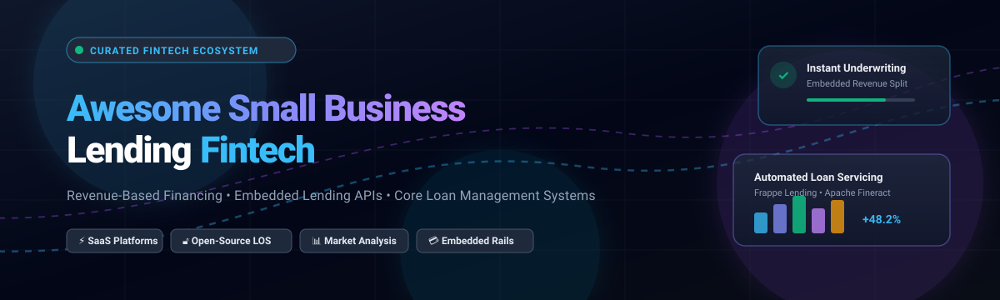
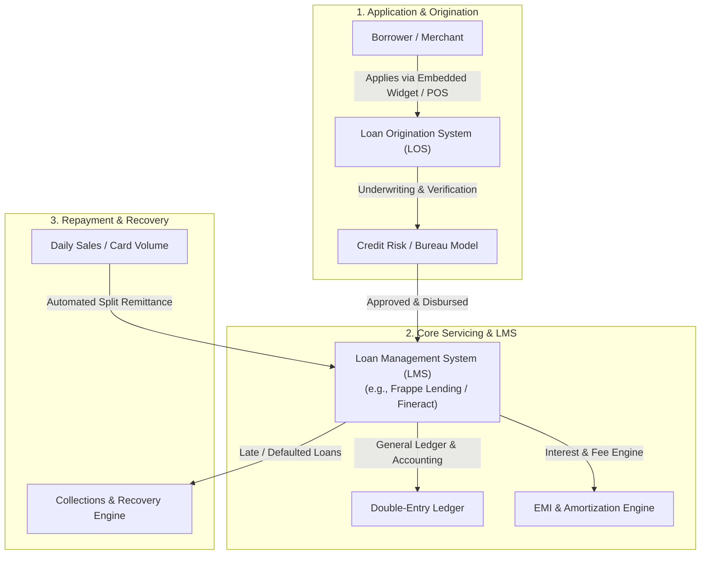

# 🏦 Awesome Small Business Lending

  

  <strong>Curated Directory of SaaS Platforms, Embedded Lending Infrastructure & Open-Source Loan Management Systems</strong>

  
  
  
  
  

---

## 📌 Table of Contents
- [📖 Overview & Key Concepts](#-overview--key-concepts)
- [📈 Sector Overview & Market Dynamics](#-sector-overview--market-dynamics)
- [☁️ SaaS / Hosted Platforms](#-saas--hosted-platforms)
- [💻 Open-Source GitHub Projects](#-open-source-github-projects)
- [🤝 How to Contribute](#-how-to-contribute)
- [⚠️ Disclaimer](#-disclaimer)

---

## 📖 Overview & Key Concepts

Welcome to **Awesome Small Business Lending**, a curated, developer- and founder-focused guide to modern credit infrastructure for small and medium enterprises (SMEs / SMBs). This index tracks the leading software solutions powering:

- 💸 **Revenue-Based Financing (RBF)**: Non-dilutive capital repaid via automatic daily/weekly percentage deductions of merchant processing revenue.
- 🛍️ **Merchant Cash Advances (MCA)**: Fast purchase of future receivables evaluated on card sales rather than traditional collateral.
- 🔌 **Embedded Lending & LaaS (Lending-as-a-Service)**: Modular APIs enabling vertical SaaS, marketplaces, and payment processors to distribute credit directly to native business users.
- ⚙️ **Core Loan Management Systems (LMS) & Loan Origination Systems (LOS)**: Full-lifecycle backends handling credit decisioning, compliance, disbursement, accounting, interest calculation, and collections.

---

## 📈 Sector Overview & Market Dynamics

> 💡 **Market Size & Growth**: The global digital small business lending market is estimated at **$18.5 Billion in 2024–2025** and is projected to surpass **$45.8 Billion by 2032**, expanding at a robust compound annual growth rate (**CAGR**) of **12.2% to 14.5%**.

> 🌐 **Market Structure & Fragmentation**: The sector exhibits a **moderately fragmented and bifurcated structure** rather than a single winner-take-all monopoly:
> - **Top-tier embedded distribution** is heavily consolidated among payment giants and e-commerce platforms (Shopify, Block/Square, Stripe, PayPal) who leverage exclusive, captive closed-loop merchant processing transaction data to deliver friction-free underwriting.
> - **Mid-market underwriting and multi-lender marketplaces** remain **highly fragmented**, featuring specialized regional balance-sheet lenders, vertical SaaS capital providers, and broker networks (Lendio, Fundbox, Funding Circle, Clearco) competing on niche underwriting risk appetite, product flexibility, and specialized collateral models.

---

## ☁️ SaaS / Hosted Platforms

The table below catalogs premier SaaS lending and embedded financing platforms, sorted in descending order by **company size (market capitalization or latest enterprise valuation)**.

| 🏢 Platform | 💰 Company Size (Valuation / Revenue) | 🏷️ Specific Starting Pricing Tier | 🎁 Free Tier Limit / Trial Plan | 🔑 Core Capability |
| :--- | :--- | :--- | :--- | :--- |
| **[Shopify Capital](https://www.shopify.com/capital)** | **$105.4B** Market Cap *(Shopify Inc. NYSE: SHOP)* | **Fixed borrowing fee: 6% to 13%** of loan amount; repaid via daily remittance (typically 10%–17% of gross daily store sales) | **No free tier**: Pre-qualification is included free with any paid Shopify store subscription ($39/mo Basic plan; 3-day free trial then $1/mo for first month) | Embedded merchant cash advances & loans with automated revenue-split repayment |
| **[PayPal Working Capital](https://www.paypal.com/us/business/working-capital)** | **$78.2B** Market Cap *(PayPal Holdings NASDAQ: PYPL)* | **Single fixed fee: from 1.5% to 18%** of total advance amount; repaid via automatic 10%–30% deduction on daily sales | **No free tier**: Checking eligibility and receiving pre-approved loan quotes is 100% free with an active PayPal Business account (0-day free trial; standard transaction fees apply) | Fast commercial loans & advances for verified PayPal merchants with no interest rates or periodic fees |
| **[Square Loans](https://squareup.com/us/en/loans)** | **$45.1B** Market Cap *(Block Inc. NYSE: SQ)* | **Fixed loan fee: starts at 5% to 15%** of principal; repaid via automatic daily deduction (standard 8%–15% of daily card volume) | **No free tier**: Free eligibility checks and dashboard access with standard Square POS account (0 days free trial, no monthly software fee for Square Point of Sale base plan) | Frictionless term loans for point-of-sale merchants based on historical payment terminal volume |
| **[Stripe Capital](https://stripe.com/capital)** | **$70.0B** Enterprise Valuation *(Stripe private equity valuation 2024–2025)* | **Flat borrowing fee: typically 6% to 14%** of principal; repaid via fixed automatic withhold rate (10% to 25% of card transaction volume) | **No free tier**: Invitation and underwriting monitoring is included free of charge with standard Stripe account (0-day trial; standard pay-as-you-go processing pricing) | Embedded financing directly inside payment rails; instantaneous next-day payout upon qualification |
| **[Wayflyer](https://wayflyer.com/)** | **$1.6B** Private Valuation *(Series B FinTech Unicorn)* | **Underwriting fee: 2% to 8%** flat cost of capital on approved advances ($10,000 to $20,000,000 funded) | **Free analytics tier forever**: Wayflyer Analytics platform provides free continuous marketing and cash-flow reporting with no expiration or paid software tier required | Revenue-based financing tailored specifically for fast-growing direct-to-consumer (D2C) e-commerce brands |
| **[Funding Circle](https://www.fundingcircle.com/)** | **$1.4B** Market Cap *(LSE: FCH / Enterprise scale)* | **Origination fee: 3.49% to 7.99%** + fixed interest rates starting at **6.99% APR** (Term loans: $25k to $500k) | **Free application & soft quote**: Instant pre-qualification check with zero application fee and zero commitment; no trial expiration | Institutional-backed small business term loans and flexible business lines of credit |
| **[Fundbox](https://fundbox.com/)** | **$1.1B** Private Valuation *(Fintech Unicorn status)* | **Draw fee starting at 4.66%** on 12-week repayment plans or **8.99%** on 24-week terms; draw fee amortized weekly | **No free tier**: Free account creation and business health monitoring with zero maintenance or annual inactivity fees (unlimited duration; only pay draw fees when tapping credit line) | Automated revolving lines of credit up to $150k and AI-driven invoice financing |
| **[Clearco](https://clear.co/)** | **$600M** Enterprise Valuation *(Restructured Growth Stage)* | **Flat fee: 1.5% to 2.5%** on invoice funding capital; or 6%–10% on direct revenue advances | **Free insights tier forever**: Benchmarking and automated cashflow insights dashboard free forever with connected Shopify/WooCommerce accounts | Non-dilutive working capital and invoice funding for omnichannel e-commerce brands |
| **[Lendio](https://www.lendio.com/)** | **$450M** Private Valuation *(Marketplace & LMS Provider)* | **0% borrower platform fee** (Lendio receives lender origination commission); loans feature interest starting at **6.00% APR** or factor rates from **1.10** | **Free search & soft check forever**: Free loan matching engine with soft credit pull, dedicated loan specialist consultation, and no obligation to borrow | Extensive loan marketplace connecting SMBs to 75+ accredited lenders and specialized lending software |
| **[Parafin](https://www.parafin.com/)** | **$200M** Private Valuation *(Series A Fintech)* | **Platform revenue-share model**: Wholesale capital margin typically **2% to 4%** above benchmark cost of capital per funded tranche | **Sandbox free tier**: Complete developer sandbox environment with full REST API and webhook simulation access forever (no trial expiration; production requires custom enterprise contract) | Full-stack embedded capital infrastructure enabling vertical SaaS platforms and marketplaces to offer white-label loans |

---

## 💻 Open-Source GitHub Projects

Open-source tooling in small business lending offers customizable backends for loan management systems (LMS), loan origination systems (LOS), and microfinance banking cores. 

The table below is sorted in descending order by **GitHub Star Count**:

| 💻 Repository | ⭐ GitHub Stars | ⚖️ License | 🛠️ Tech Stack | 🎯 Core Focus & Architecture |
| :--- | :--- | :--- | :--- | :--- |
| **[Apache Fineract](https://github.com/apache/fineract)** |  | Apache-2.0 | Java, Spring Boot, MySQL/PostgreSQL | Enterprise-grade core banking engine for digital microfinance, loan portfolio administration, multi-currency credit rules, and accrual accounting. |
| **[Mifos X Web App](https://github.com/openMF/web-app)** |  | MPL-2.0 | Angular, TypeScript, Bootstrap | Standard modern single-page web UI for Apache Fineract, delivering loan officer portals, client KYC tracking, and credit disbursement management. |
| **[Frappe Lending](https://github.com/frappe/lending)** |  | GPL-3.0 | Python, Frappe Framework, MariaDB | Complete, production-scale loan management system built for ERPNext. Manages end-to-end lifecycle: EMI calculation, NPA classification, interest accrual, credit bureau exports, and co-lending splits. |
| **[Laravel Loan Management Demo](https://github.com/LaravelDaily/Laravel-Loan-Management-Demo)** |  | MIT | PHP, Laravel, Blade, MySQL | Practical blueprint for small loan origination, customer application verification, repayment schedule generation, and role-based staff administration. |
| **[openNPL](https://github.com/open-risk/openNPL)** |  | GPL-3.0 | Python, Django, REST API | Specialized platform for managing non-performing loan (NPL) portfolios according to European Banking Authority (EBA) data templates. |
| **[Loan Management System Django](https://github.com/Nahidjc/loan-management-system-django)** |  | MIT | Python, Django, Bootstrap | Lightweight web portal for borrower registration, automated monthly EMI payment tracking, and admin loan approval workflows. |
| **[Loan Application Backend](https://github.com/punit3299/loan-application-backend)** |  | MIT | Java, Spring Boot, Hibernate | Modular microservice API handling loan application ingestion, credit approval status tracking, and customer balance ledgers. |
| **[LendFlow](https://github.com/Hruthik2311/LendFlow)** |  | MIT | Node.js, Express, React 19, PostgreSQL | Modern recovery and delinquency management system featuring EMI calculations, field recovery agent assignment, and real-time payment updates. |
| **[LaaS (Loan-as-a-Service)](https://github.com/olukinni-029/LaaS)** |  | MIT | Node.js, TypeScript, Express, MongoDB | Headless lending API providing RBAC (Admin, Lender, Borrower, Agent), token-based authentication, and agent commission tracking. |

---

## 🔍 Architecture & Framework Comparison

---

## 🤝 How to Contribute

Contributions are warmly welcomed! Please help expand this ecosystem guide:

1. 🍴 **Fork the repository** on GitHub.
2. 🌿 **Create a new branch**: `git checkout -b feature/add-lending-platform`.
3. 📝 **Add your entry** to the appropriate table or section following the established format:
   - Platform / Repository Name with official URL
   - Transparent, verified pricing & free tier parameters (or GitHub star count and tech stack)
   - Objective, factual architectural summary
4. 🚀 **Commit and push** your changes.
5. 📬 **Open a Pull Request** with a brief summary of the project.

---

## ⚠️ Disclaimer

- ⚖️ **Regulatory Compliance**: Operating a commercial lending program requires strict adherence to jurisdictional credit laws, including consumer and commercial lending licenses, truth-in-lending disclosure rules, fair lending regulations, and AML/KYC requirements.
- 💡 **Informational Purpose**: This directory is curated for informational, educational, and developer evaluation purposes. Inclusion does not imply financial endorsement or partnership.
- 📜 **Software Licensing**: Verify the license of each open-source project (GPL-3.0, Apache-2.0, MIT, MPL-2.0) before embedding into commercial software systems.

---

  Built with ❤️ for fintech engineers, lending operators, and embedded credit innovators worldwide.

